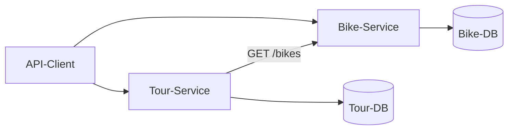

# Technologie und Infrastruktur (P1)

> Zurück zur [Dokumentation](README.md)

## Projekt

- 2 Web-APIs, je eigenes Projekt und eigene DB, kein Frontend
- Bike-Service (`Code/bike-service/`)
  - US1 · `POST /bikes` – Typ, Rahmennummer, Radhöhe, automatische ID und Erstellungsdatum
  - US2 · `GET /bikes` – vollständige Liste, Tests für leere Liste, Fehlerfälle und Antwortzeit
- Tour-Service (`Code/tour-service/`)
  - US3 · `POST /tours` – Start/Ziel, Start-/Endzeit, Begleiter, Bike-ID
  - Validierung · Start ≠ Ziel, Ende nach Start, Bike-ID via `GET /bikes`

## Auswahl (Teamfreigabe offen)

- APIs · Java 21, Spring Boot (REST, Validierung)
- Build und Tests · Maven je Service, JUnit / Spring Boot Test (Unit, Integration)
- Daten · PostgreSQL (2 DBs, eigene Benutzer, `UNIQUE` für Rahmennummer), lokal via Docker Compose
- CI/CD · GitHub Actions je Service
- Hosting · Container + PostgreSQL, Anbieter und Kosten offen
- Organisation · bestehende GitHub Issues / Projects, gemeinsames Excel (Zeit pro Task)
- Git · Feature-Branch → Pull Request → Review → Merge

## Alternativen

- C# / ASP.NET Core + PostgreSQL · REST, Tests, CI/CD
- Gleiche Sprache für beide Services · weniger Lern- und Wartungsaufwand
- MongoDB · feste Felder und Constraints sprechen für PostgreSQL
- GitLab CI · Plattformwechsel bei Nutzung nötig

## Offene Prüfungen

- Teamwissen · Java / C#
- Services · unabhängiger Build und Start, getrennte DB-Zugriffe
- Tour-Tests · Ausfall der Bike-API, Ablehnung ungültiger Bike-ID
- Hosting · Kosten, Zugriff für Lehrperson, Secrets

## Quellen

- [Spring REST](https://spring.io/guides/gs/rest-service)
- [PostgreSQL Constraints](https://www.postgresql.org/docs/17/ddl-constraints.html)
- [Docker Compose](https://docs.docker.com/compose/intro/compose-application-model)
- [GitHub Actions / Maven](https://docs.github.com/en/actions/tutorials/build-and-test-code/java-with-maven)
