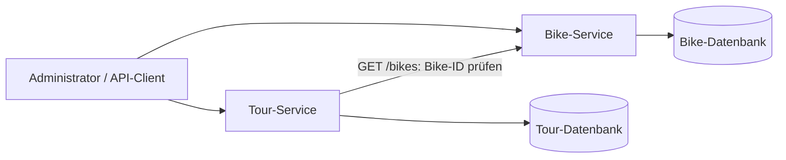

# Technologie- und Infrastrukturentscheid (P1)

> Zurück zur [Dokumentationsübersicht](README.md)

**Status:** Entscheidungsvorschlag, zur Bestätigung durch das Team. Die fachlichen Anforderungen stammen aus dem vorgegebenen Projektauftrag; Teamwissen, Cloud-Kosten und tatsächliche Testläufe sind noch nicht verifiziert.

## Projekt und Architektur

Backend ohne Frontend, zwei unabhängige Web-APIs im gemeinsamen Repository:

| Service | Endpoint | Aufgabe |
| --- | --- | --- |
| Bike-Service | POST /bikes | Bike erfassen (Typ, Rahmennummer, Radhöhe; ID und Datum automatisch) |
| Bike-Service | GET /bikes | Alle Bikes mit vollständigen Daten auslesen |
| Tour-Service | POST /tours | Tour mit Orten, Zeiten, Begleiter und Bike-ID erfassen |

- Eigene Maven-Projekte unter `Code/bike-service/` und `Code/tour-service/`.
- Eigene Datenbanken und Zugangsdaten; keine serviceübergreifenden SQL-Abfragen.
- Bei ungültigem Bike oder Ausfall des Bike-Service keine Tour ohne Validierung speichern.
- Begleiter-Datenquelle und Antwort bei leerer Bike-Liste mit dem Team klären. Keine zusätzlichen fachlichen Endpoints ohne Bedarf.

## Empfohlene Wahl

| Bereich | Vorschlag | Begründung |
| --- | --- | --- |
| Sprache/Framework | Java 21 (LTS), Spring Boot, Maven | REST-APIs, Validierung, Datenbankzugriff und etablierte Tests; gleiche Technologie für beide Dienste reduziert Lern- und Pipelineaufwand. Konkrete kompatible Version gemeinsam festlegen. |
| Datenbank | PostgreSQL, je Service eine Datenbank und eigener Benutzer | Strukturierte Daten, Pflichtfelder und eindeutige Rahmennummer über Constraints; unabhängig voneinander veränderbar. |
| Tests | JUnit, Spring Boot Test | Unit-Tests für Validierung, Controller-/Integrationstests für HTTP und Persistenz. Bike-Aufruf im Tour-Service auch mit Fehlerfällen testen. |
| Lokaler Betrieb | Docker Compose | Beide APIs und getrennte Datenbanken reproduzierbar starten; kein Kubernetes nötig. |
| Git / Kanban | GitHub, GitHub Issues und Projects | Bereits vorhandenes Repository und Board, nachvollziehbare PRs und Aufgaben. |
| CI/CD | GitHub Actions | Je Projekt separat bauen, testen und später deployen; PR-Checks und Logs direkt im Repository. |
| Hosting | Containerfähiges Hosting mit PostgreSQL, bevorzugt vorhandene Schul-/Cloud-Umgebung | Zwei unabhängig deploybare Dienste; Anbieter, Kosten, Zugriff der Lehrperson und Datenbankhosting vor CD verbindlich klären. |
| API-Dokumentation | OpenAPI bzw. dokumentierte HTTP-Beispiele | Drei Endpoints mit Request, Response und Fehlerfällen nachvollziehbar testen. |

## Variantenvergleich

| Kriterium | Java / Spring Boot + PostgreSQL | C# / ASP.NET Core + PostgreSQL |
| --- | --- | --- |
| REST und Validierung | Spring MVC, Bean Validation | ASP.NET Core Web API, Data Annotations |
| Testbarkeit | JUnit, Spring Boot Test | xUnit, ASP.NET Core-Testhost |
| CI/CD | Maven, GitHub Actions | dotnet CLI, GitHub Actions |
| Betrieb | Container, eigener Java-Build pro Service | Container, eigener .NET-Build pro Service |
| Team-Fit | zu bestätigen: Java-/Spring-Erfahrung | zu bestätigen: C#-/.NET-Erfahrung |

Beide Varianten erfüllen den Auftrag. Der Vorschlag ist Java/Spring Boot, sofern das Team damit ausreichend vertraut ist. Zwei unterschiedliche Sprachen erhöhen den Wartungs- und Lernaufwand, ohne hier erkennbaren Nutzen zu bringen. PostgreSQL statt MongoDB: die Bikes und Touren haben feste Felder und klare Validierungsanforderungen; relationale Constraints passen gut dazu. GitLab CI wäre ebenfalls möglich; ein Plattformwechsel erzeugt aktuell unnötigen Aufwand.

## Risiken und Prüfschritte

| Risiko | Prüfung vor der Umsetzung |
| --- | --- |
| Teamkenntnisse unterschiedlich | Kurz gemeinsam ein REST-Minimalprojekt bauen und einen Unit-Test ausführen. |
| Datenbankkopplung | Zwei DB-Benutzer einrichten; prüfen, dass jeder nur auf seine DB zugreift. |
| Bike-Service nicht erreichbar | Tour-API mit gültigem, unbekanntem und nicht erreichbarem Bike-Service testen. |
| CI- und Cloud-Kosten | Beide Builds in der Pipeline testen; Hosting-Kosten, Zugriffsrechte und Limits prüfen. |
| Geheimnisse und öffentliche API | Keine DB-Passwörter im Git; Umgebungsvariablen/Secrets, HTTPS und erforderliche Zugriffsabsicherung vor Deployment klären. |

## Freigabe durch das Team

- Finaler Entscheid, Datum und Beteiligte: noch gemeinsam bestätigen.
- Team-Erfahrung und Ergebnisse der Prüfschritte: nachtragen.
- Falls Hosting oder Testbarkeit nicht erfüllt sind, Alternative erneut bewerten.

## Quellen

- [Spring – RESTful Web Service](https://spring.io/guides/gs/rest-service)
- [PostgreSQL – Constraints](https://www.postgresql.org/docs/17/ddl-constraints.html)
- [Docker – Compose](https://docs.docker.com/compose/intro/compose-application-model)
- [GitHub – Java mit Maven bauen und testen](https://docs.github.com/en/actions/tutorials/build-and-test-code/java-with-maven)

